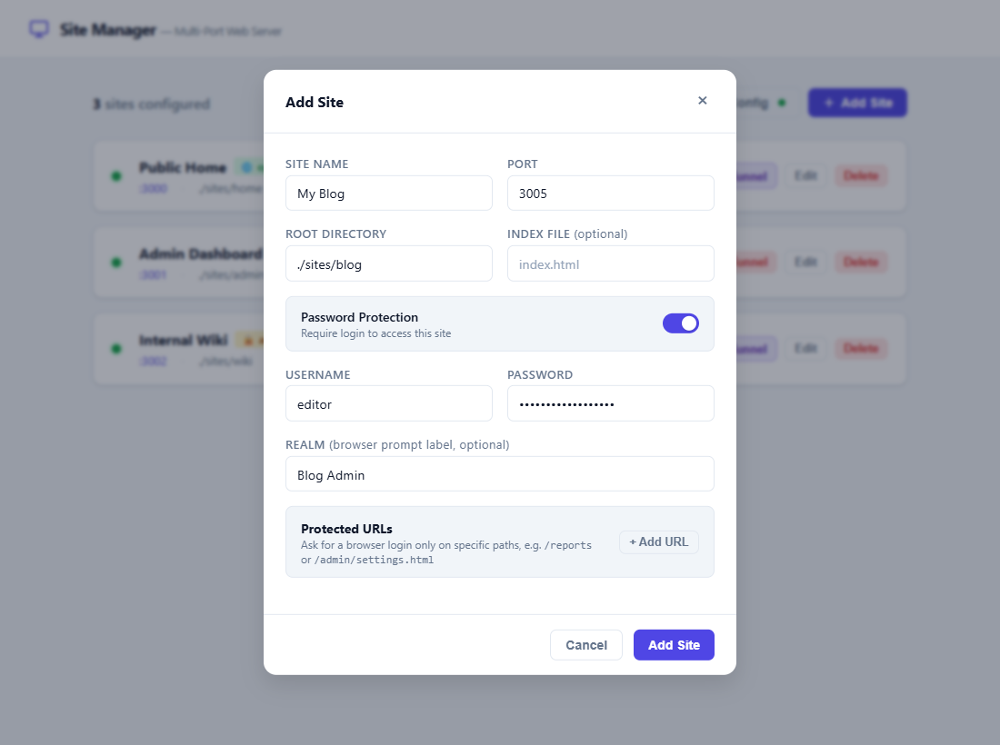
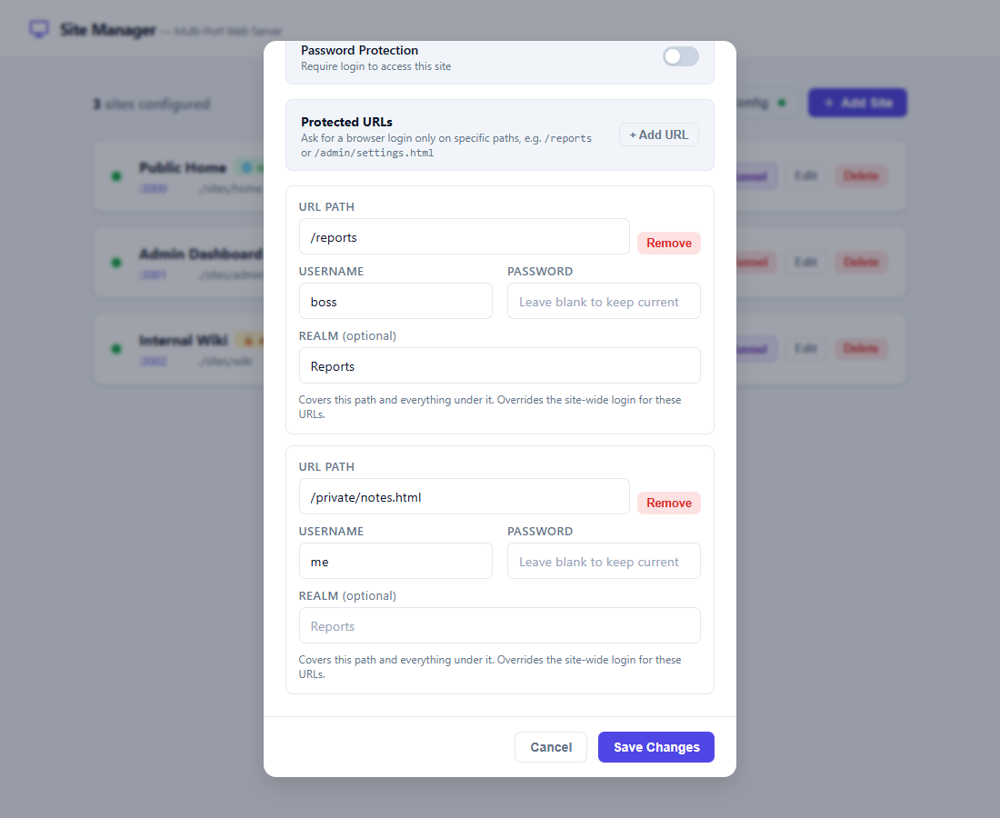

# RoWeb — Multi-Port Web Server

A zero-dependency Node.js web server that hosts multiple static sites on separate ports, each with optional password protection, a browser-based management UI, and a built-in reverse proxy tunnel system for exposing local sites to the public internet.

**No npm install required. Runs with `node server.js`.**

---

## Table of Contents

1. [Features](#features)
2. [Requirements](#requirements)
3. [Project Structure](#project-structure)
4. [Quick Start](#quick-start)
5. [Configuration](#configuration)
6. [Site Manager UI](#site-manager-ui)
7. [Password Protection & Rate Limiting](#password-protection--rate-limiting)
   - [Protecting Specific URLs](#protecting-specific-urls)
8. [Tunnel System](#tunnel-system)
   - [How It Works](#how-it-works)
   - [Step 1 — Configure via Site Manager](#step-1--configure-via-site-manager)
   - [Step 2 — Deploy the Tunnel Server on Your VPS](#step-2--deploy-the-tunnel-server-on-your-vps)
   - [Step 3 — Create a Tunnel](#step-3--create-a-tunnel)
9. [Running in Production](#running-in-production)
10. [Security Notes](#security-notes)
11. [Default Credentials](#default-credentials)

---

## Features

| Feature | Details |
|---|---|
| **Multi-port hosting** | Each site runs on its own port, fully isolated |
| **Per-site Basic Auth** | Browser-native login dialog, configured per site |
| **Per-URL logins** | Require a browser login only on specific paths (e.g. `/reports`) |
| **Rate limiting** | 5 failed attempts → 10-minute lockout per IP per site, survives restarts |
| **Live Site Manager** | Add, edit, and delete sites from a browser UI without restarting |
| **Reverse proxy tunnels** | Expose any local site to the internet via a secure public URL |
| **Tunnel Config UI** | Set your domain, certs, and token from the browser — no file editing |
| **Zero dependencies** | Only Node.js built-ins (`http`, `https`, `fs`, `net`, `tls`, `crypto`) |

---

## Requirements

- **Node.js 18 or newer**
- No npm, no package.json, no installs

---

## Project Structure

```
roweb/
├── server.js               ← Main entry point
├── config.json             ← Site definitions
├── lib/
│   ├── auth.js             ← HTTP Basic Auth + rate limiting
│   ├── fileServer.js       ← Static file serving
│   ├── logger.js           ← Startup table + request logs
│   ├── manager.js          ← Site Manager API server
│   ├── mimeTypes.js        ← MIME type map
│   └── securityHeaders.js  ← Security response headers
├── data/                   ← Persisted lockouts (created at runtime, gitignored)
├── tunnel/
│   ├── server.js           ← Tunnel server (deploy on VPS)
│   ├── client.js           ← Tunnel client (runs locally)
│   ├── protocol.js         ← Shared binary frame protocol
│   └── tunnel-config.json  ← Tunnel settings (gitignored)
└── sites/
    ├── home/               ← Sample public site (port 3000)
    ├── admin/              ← Sample protected site (port 3001)
    ├── wiki/               ← Sample protected site (port 3002)
    └── manager/            ← Site Manager UI (port 4000)
```

---

## Quick Start

**1. Clone the repository**

```bash
git clone https://github.com/rbughao/RoWeb.git
cd RoWeb
```

**2. Start the server**

```bash
node server.js
```

You'll see a startup table like this:

```
╔═════════════════════════════════════════════════════╗
║           Multi-Port Web Server — Started           ║
╠═════════════════════════════════════════════════════╣
║  Public Home      http://localhost:3000   [auth]    ║
║  Admin Dashboard  http://localhost:3001   [auth]    ║
║  Internal Wiki    http://localhost:3002   [auth]    ║
╚═════════════════════════════════════════════════════╝
Press Ctrl+C to stop all servers.
Manager UI → http://localhost:4000
```

**3. Open the Site Manager**

Navigate to [http://localhost:4000](http://localhost:4000) in your browser.
Default credentials: `admin` / `manager123`. See [Site Manager UI](#site-manager-ui) for a walkthrough.

---

## Configuration

All sites are defined in `config.json` at the project root.

```json
{
  "manager": {
    "port": 4000,
    "auth": {
      "user": "admin",
      "pass": "manager123",
      "realm": "Site Manager"
    }
  },
  "sites": [
    {
      "name": "Public Home",
      "port": 3000,
      "root": "./sites/home"
    },
    {
      "name": "Admin Dashboard",
      "port": 3001,
      "root": "./sites/admin",
      "auth": {
        "user": "admin",
        "pass": "secret123",
        "realm": "Admin Area"
      }
    },
    {
      "name": "Internal Wiki",
      "port": 3002,
      "root": "./sites/wiki",
      "index": "wiki.html",
      "auth": {
        "user": "team",
        "pass": "wiki2024"
      }
    }
  ]
}
```

### Site fields

| Field | Required | Description |
|---|---|---|
| `name` | Yes | Human-readable label shown in logs and UI |
| `port` | Yes | Port to bind this site to |
| `root` | Yes | Path to the folder containing the site's files |
| `index` | No | Entry file (default: `index.html`) |
| `auth.user` | If auth | Username for Basic Auth |
| `auth.pass` | If auth | Password for Basic Auth |
| `auth.realm` | No | Label shown in the browser's login dialog |
| `protectedPaths` | No | List of URL-specific logins — see [Protecting Specific URLs](#protecting-specific-urls) |

### Manager fields

| Field | Required | Description |
|---|---|---|
| `manager.port` | Yes | Port for the Site Manager UI |
| `manager.auth` | Recommended | Login for the Site Manager (same shape as site `auth`) |
| `manager.allowedHosts` | No | Extra hostnames allowed to reach the manager, e.g. `["myserver.lan"]`. `localhost` and IP addresses always work. Anything else gets `403` (blocks DNS-rebinding attacks). |

> **Tip:** You can also manage all of this from the Site Manager UI — changes take effect immediately without restarting.

---

## Site Manager UI

Open [http://localhost:4000](http://localhost:4000) in your browser.

Each site is shown as a card:

- **Green dot / `running`**: the site's server is listening on its port
- **`open`** or **`auth`**: whether the whole site needs a login
- **`N protected URLs`**: how many paths have their own login (the paths are listed under the name)
- **Tunnel link**: the public URL, when a tunnel is active
- **Tunnel Config dot**: grey = tunnel not configured yet, green = ready


### Adding a site (step by step)

1. Create a folder for the site's files, e.g. `sites/blog/`, and put an `index.html` in it
2. Click **+ Add Site**
3. Fill in **Site Name**, a free **Port** (e.g. `3005`) and the **Root Directory** (`./sites/blog`)
4. *(Optional)* Turn on **Password Protection** to put the whole site behind a login, then set a username, password and realm (the label shown in the browser's login box)
5. *(Optional)* Click **+ Add URL** to protect only certain paths. See [Protecting Specific URLs](#protecting-specific-urls)
6. Click **Add Site**. The site starts right away at `http://localhost:3005`, with no restart needed



### What you can do

| Action | How |
|---|---|
| **Add a site** | Click **+ Add Site**, fill in name, port, root directory, and optionally enable password protection |
| **Edit a site** | Click **Edit** on any site card — the server on that port restarts with new settings |
| **Delete a site** | Click **Delete** — stops the server and removes it from config |
| **Toggle auth** | Use the toggle switch in the Add/Edit form to enable or disable password protection |
| **Protect a specific URL** | In the Add/Edit form, click **+ Add URL** under *Protected URLs* |
| **Change a password** | Type a new one in Edit. Leave it blank to keep the current password — passwords are never sent back to the browser |
| **Create a tunnel** | Click **🔗 Tunnel** on any site card to expose it to the internet |
| **Stop a tunnel** | Click **Stop Tunnel** on the active card |
| **Configure tunnel** | Click **Tunnel Config** in the toolbar |

---

## Password Protection & Rate Limiting

### Enabling auth on a site

Add an `auth` block to the site in `config.json`, or toggle **Password Protection** in the Site Manager UI:

```json
"auth": {
  "user": "myuser",
  "pass": "mypassword",
  "realm": "My Protected Site"
}
```

When a browser accesses a protected site it shows the native login dialog. All files on that port — HTML, CSS, images, everything — require valid credentials.

### Rate limiting

To prevent brute-force attacks, failed login attempts are tracked **per IP address per port**:

- After **5 failed attempts**, that IP is locked out for **10 minutes**
- The lockout countdown is sent in the `Retry-After` response header
- Even correct credentials are rejected during a lockout
- A successful login resets the attempt counter
- Lockouts are saved to `data/login-attempts.json`, so restarting the server doesn't clear them
- Tunnelled visitors are tracked by their real public IP (passed by the tunnel server in `X-Forwarded-For`)

```
HTTP/1.1 429 Too Many Requests
Retry-After: 600
```

### Protecting Specific URLs

You can require a browser login on specific paths only — for example, keep a site public but lock down `/reports`.

**From the Site Manager:**

1. Click **Edit** on the site
2. Under **Protected URLs**, click **+ Add URL** (once per path)
3. Enter the **URL path** (e.g. `/reports`), a **username**, a **password**, and optionally a **realm**
4. Click **Save Changes**. It takes effect immediately; visiting that URL now pops up the browser's login box

When editing an existing rule, leave the password blank to keep the current one. Click **Remove** to delete a rule.



**From `config.json`:**

```json
{
  "name": "Public Home",
  "port": 3000,
  "root": "./sites/home",
  "protectedPaths": [
    { "path": "/reports", "user": "boss",   "pass": "reportpw", "realm": "Reports" },
    { "path": "/private/notes.html", "user": "me", "pass": "notespw" }
  ]
}
```

How rules are matched:

| Rule | Protects |
|---|---|
| `/reports` | `/reports`, `/reports/`, `/reports/q1.html`, `/reports/2026/summary.pdf`, … |
| `/private/notes.html` | Only that one file |
| `/` | The whole site |

- Matching is **case-insensitive** and works on the real file path, so tricks like `/REPORTS`, `/%72eports` or `/./reports` can't bypass a rule.
- If several rules match, the **most specific (longest) path wins**.
- A matching rule **replaces** the site-wide login for those URLs (a browser can only send one login per request), so you can give different people access to different areas.
- Rate limiting applies to URL logins too.

---

## Tunnel System

The tunnel system lets you share any locally running site with anyone on the internet using a secure public URL like `https://a3f9c1b2.yourdomain.com`.

### How It Works

```
Public User
    │  HTTPS  → a3f9c1b2.yourdomain.com
    ▼
Tunnel Server (your VPS)
    │  persistent TCP connection
    ▼
Tunnel Client (your local machine)
    │  HTTP  → localhost:3001
    ▼
Local Site (running via server.js)
```

### Prerequisites

You need:
- A **VPS** (DigitalOcean, Hetzner, Linode, etc.) with a public IP address
- A **domain name** with a **wildcard DNS record**: `*.yourdomain.com → VPS IP`
- A **TLS certificate** covering `*.yourdomain.com` — [Let's Encrypt](https://letsencrypt.org/) with certbot is free
- Ports **80**, **443**, and **7000** open on your VPS firewall

---

### Step 1 — Configure via Site Manager

1. Open the Site Manager at [http://localhost:4000](http://localhost:4000)
2. Click **Tunnel Config** in the top toolbar
3. Fill in the form:

| Field | Example | Notes |
|---|---|---|
| **Domain** | `yourdomain.com` | Used to build public URLs |
| **Control Port** | `7000` | Port the tunnel clients connect to on your VPS |
| **TLS Certificate** | `/etc/letsencrypt/live/yourdomain.com/fullchain.pem` | Full path on the VPS |
| **TLS Key** | `/etc/letsencrypt/live/yourdomain.com/privkey.pem` | Full path on the VPS |
| **Shared Token** | *(click Generate)* | Secret shared between server and client — keep this private |
| **Server Host** | `yourdomain.com` | Auto-filled from Domain field |
| **TLS on control** | Off | Enable only if your control port uses HTTPS |
| **Allow self-signed certificate** | Off | Skips certificate checks on the control connection. Development only — leave off in production |

Optional settings you can add by hand to the `server` block of `tunnel-config.json`:

| Field | Default | Description |
|---|---|---|
| `maxBodyBytes` | `10485760` (10 MB) | Larger request bodies get `413 Payload Too Large` |
| `requestTimeout` | `30000` | Milliseconds to wait for the local site before returning `504` |


4. Click **Save Config**. This writes `tunnel/tunnel-config.json` locally, and the dot on the **Tunnel Config** button turns green

5. **Copy the same file to your VPS** at the same relative path:
   ```bash
   scp tunnel/tunnel-config.json user@your-vps:~/RoWeb/tunnel/tunnel-config.json
   ```

---

### Step 2 — Deploy the Tunnel Server on Your VPS

SSH into your VPS and run:

```bash
git clone https://github.com/rbughao/RoWeb.git
cd RoWeb

# Copy your tunnel config (or scp it as shown above)
# Then start the tunnel server:
node tunnel/server.js
```

You should see:

```
Tunnel server ready — domain: *.yourdomain.com
Control server  :7000
Public HTTPS    :443  (*.yourdomain.com)
HTTP redirect   :80  → HTTPS
```

> **Tip for production:** Use a process manager like `pm2` or a `systemd` service so the tunnel server restarts automatically.

```bash
# Example with pm2
npm install -g pm2
pm2 start tunnel/server.js --name roweb-tunnel
pm2 save
pm2 startup
```

---

### Step 3 — Create a Tunnel

**Option A — via Site Manager UI (recommended)**

1. Open [http://localhost:4000](http://localhost:4000)
2. Find the site you want to expose
3. Click the **🔗 Tunnel** button
4. The card updates instantly with a clickable public URL:
   `🌐 https://a3f9c1b2.yourdomain.com`
5. Click **Stop Tunnel** to disconnect

**Option B — via CLI**

```bash
# Expose local port 3001 to the internet
node tunnel/client.js --port 3001

# With explicit options (overrides tunnel-config.json)
node tunnel/client.js --port 3001 --server yourdomain.com --token YOUR_SECRET

# All flags
node tunnel/client.js \
  --port 3001 \
  --server yourdomain.com \
  --control-port 7000 \
  --token YOUR_SECRET \
  --subdomain mysite \
  --tls \
  --insecure        # accept a self-signed cert (dev only)
```

If the connection drops, the client reconnects automatically, waiting 3 s, then 6 s, 12 s … up to 60 s between attempts.

Output:

```
[Tunnel] Connecting to yourdomain.com:7000 for localhost:3001...
[Tunnel] Active → https://a3f9c1b2.yourdomain.com
```

Press `Ctrl+C` to stop the tunnel.

---

### Tunnel behaviour

| Scenario | Result |
|---|---|
| Client disconnects | Public URL returns `502 Bad Gateway` |
| Client reconnects | Same subdomain is restored automatically |
| Request times out | Returns `504 Gateway Timeout` after 30 seconds |
| Site has Basic Auth | Auth challenge is preserved end-to-end |
| Wrong tunnel token | Server rejects with `401 Unauthorized` |
| Request body over `maxBodyBytes` | Returns `413 Payload Too Large` |

---

## Running in Production

For long-running deployments on a server:

```bash
# Keep the server running with pm2
npm install -g pm2

pm2 start server.js --name roweb
pm2 save
pm2 startup

# View logs
pm2 logs roweb

# Restart
pm2 restart roweb
```

Or use a simple `systemd` unit file — see your distro's documentation.

---

## Security Notes

- **`tunnel/tunnel-config.json` is gitignored** — it contains your token and cert paths and should never be committed
- Change **all default passwords** before deploying publicly — the server prints a warning while the manager uses the default
- The shared tunnel token should be at least 32 random characters — use the **Generate** button in the UI
- Passwords and tokens are compared in constant time (SHA-256 + `timingSafeEqual`), so neither content nor length leaks through timing
- Rate limiting is per-IP per-port, persists across restarts, and applies to tunnelled traffic by real client IP
- Directory traversal (`../`, `%2e%2e`, null bytes) is blocked with `403 Forbidden`
- The tunnel client verifies the server's TLS certificate unless you explicitly enable insecure mode
- Hop-by-hop headers are stripped when proxying; `X-Forwarded-For` is overwritten so visitors can't spoof their IP
- HTTP → HTTPS redirects only ever point at your own domain
- All servers time out slow requests (10 s for headers, 30 s for the full request)
- Security headers on every response: `X-Content-Type-Options`, `X-Frame-Options`, `Referrer-Policy`, plus a strict `Content-Security-Policy` on the Site Manager

### Site Manager API protection

- Passwords are **never returned** by the API, so leave a password blank when editing to keep it
- No CORS headers are sent, so other websites can't read API responses
- Every state-changing API call (`POST`/`PUT`/`DELETE`) must include the header `X-Requested-With: RoWeb`, and a cross-site `Origin` is rejected. This blocks CSRF. If you script against the API, add the header:
  ```bash
  curl -u admin:manager123 -H "X-Requested-With: RoWeb" -X DELETE http://localhost:4000/api/sites/3002
  ```
- Requests whose `Host` isn't `localhost`, an IP address, or listed in `manager.allowedHosts` are rejected (DNS-rebinding protection)

---

## Default Credentials

> **Change these before exposing any site to the internet.**

| Site | Port | Username | Password |
|---|---|---|---|
| Public Home | 3000 | — (open) | — |
| Admin Dashboard | 3001 | `admin` | `secret123` |
| Internal Wiki | 3002 | `team` | `wiki2024` |
| **Site Manager** | **4000** | **`admin`** | **`manager123`** |

---

## License

MIT
