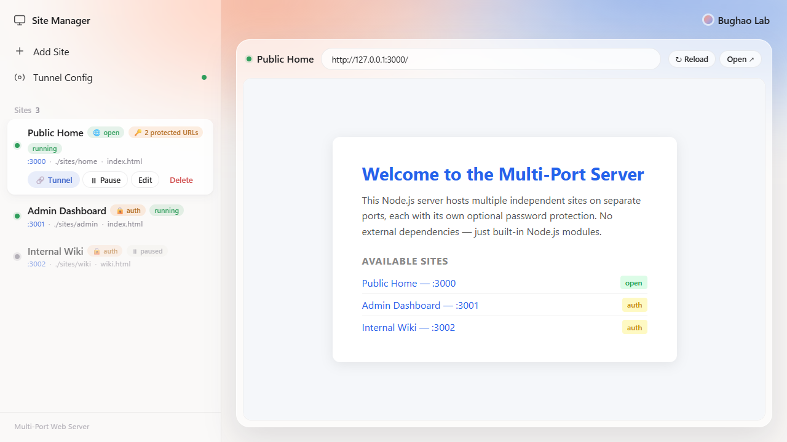
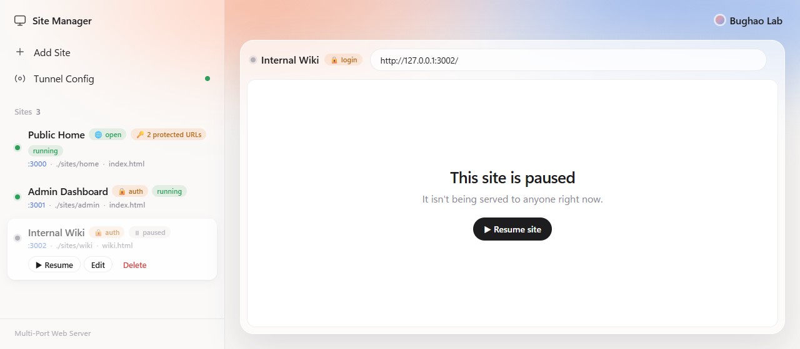
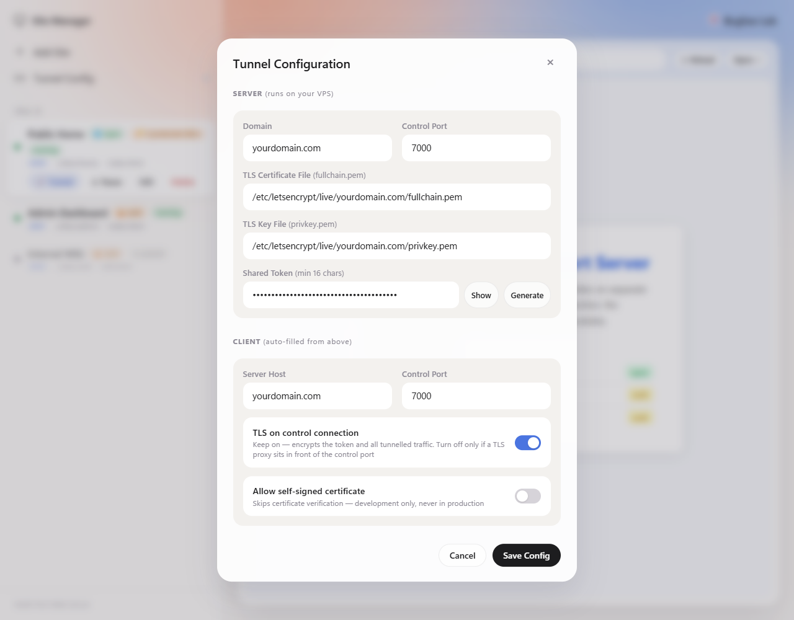

# RoWeb — Multi-Port Web Server

A zero-dependency Node.js web server that hosts multiple static sites on separate ports, each with optional password protection, a browser-based management UI, and a built-in reverse proxy tunnel system for exposing local sites to the public internet.

**No npm install required. Runs with `node server.js`.**

---

## Table of Contents

1. [Features](#features)
2. [Requirements](#requirements)
3. [Project Structure](#project-structure)
4. [Quick Start](#quick-start)
5. [Configuration](#configuration)
6. [Site Manager UI](#site-manager-ui)
   - [Pausing a site](#pausing-a-site)
7. [Password Protection & Rate Limiting](#password-protection--rate-limiting)
   - [Protecting Specific URLs](#protecting-specific-urls)
8. [Tunnel System](#tunnel-system)
   - [How It Works](#how-it-works)
   - [Step 1 — Configure via Site Manager](#step-1--configure-via-site-manager)
   - [Step 2 — Deploy the Tunnel Server on Your VPS](#step-2--deploy-the-tunnel-server-on-your-vps)
   - [Step 3 — Create a Tunnel](#step-3--create-a-tunnel)
9. [Running in Production](#running-in-production)
10. [Security Notes](#security-notes)
11. [Passwords & First Run](#passwords--first-run)

---

## Features

| Feature | Details |
|---|---|
| **Multi-port hosting** | Each site runs on its own port, fully isolated |
| **Per-site Basic Auth** | Browser-native login dialog, configured per site |
| **Per-URL logins** | Require a browser login only on specific paths (e.g. `/reports`) |
| **Rate limiting** | 5 failed attempts → 10-minute lockout per IP per site, survives restarts |
| **Hashed passwords** | Stored as scrypt hashes; default or missing passwords are replaced with random ones on startup |
| **Live Site Manager** | Add, edit, pause, resume and delete sites from a browser UI without restarting, with a live preview of the selected site |
| **Reverse proxy tunnels** | Expose any local site to the internet via a secure public URL |
| **Tunnel Config UI** | Set your domain, certs, and token from the browser — no file editing |
| **Zero dependencies** | Only Node.js built-ins (`http`, `https`, `fs`, `net`, `tls`, `crypto`) |

---

## Requirements

- **Node.js 18 or newer**
- No npm, no package.json, no installs

---

## Project Structure

```
roweb/
├── server.js               ← Main entry point
├── config.example.json     ← Template site definitions (committed)
├── config.json             ← Your real config — created on first run, gitignored
├── lib/
│   ├── auth.js             ← HTTP Basic Auth + rate limiting
│   ├── fileServer.js       ← Static file serving
│   ├── logger.js           ← Startup table + request logs
│   ├── manager.js          ← Site Manager API server
│   ├── mimeTypes.js        ← MIME type map
│   ├── passwords.js        ← scrypt password hashing
│   └── securityHeaders.js  ← Security response headers
├── data/                   ← Persisted lockouts (created at runtime, gitignored)
├── tunnel/
│   ├── server.js           ← Tunnel server (deploy on VPS)
│   ├── client.js           ← Tunnel client (runs locally)
│   ├── protocol.js         ← Shared binary frame protocol
│   └── tunnel-config.json  ← Tunnel settings (gitignored)
└── sites/
    ├── home/               ← Sample public site (port 3000)
    ├── admin/              ← Sample protected site (port 3001)
    ├── wiki/               ← Sample protected site (port 3002)
    └── manager/            ← Site Manager UI (port 4000)
```

---

## Quick Start

**1. Clone the repository**

```bash
git clone https://github.com/rbughao/RoWeb.git
cd RoWeb
```

**2. Start the server**

```bash
node server.js
```

On the first run, `config.json` is created from `config.example.json`, and a **random password is generated for every login**. They're printed **once**, so copy them now:

```
Created config.json from config.example.json.

These logins had no password or a publicly known default password.
New random passwords were generated. They are shown ONCE — note them now:

  Site Manager                     user: admin      pass: <random-16-chars>
  Admin Dashboard                  user: admin      pass: <random-16-chars>
  Internal Wiki                    user: team       pass: <random-16-chars>

╔═════════════════════════════════════════════════════╗
║           Multi-Port Web Server — Started           ║
╠═════════════════════════════════════════════════════╣
║  Public Home      http://localhost:3000     [open]  ║
║  Admin Dashboard  http://localhost:3001     [auth]  ║
║  Internal Wiki    http://localhost:3002     [auth]  ║
╚═════════════════════════════════════════════════════╝
Press Ctrl+C to stop all servers.
Manager UI → http://127.0.0.1:4000
```

Lost them, or want your own? See [Passwords & First Run](#passwords--first-run).

**3. Open the Site Manager**

Navigate to [http://127.0.0.1:4000](http://127.0.0.1:4000) and log in as `admin` with the Site Manager password from the console. See [Site Manager UI](#site-manager-ui) for a walkthrough.

> The manager only listens on `127.0.0.1`, so it can only be opened from this computer. Use `127.0.0.1` rather than `localhost` — on Windows, `localhost` tries IPv6 first and each request waits about 200 ms before falling back.

---

## Configuration

All sites are defined in `config.json` at the project root. It's created from `config.example.json` on first run and is **gitignored**, so your settings and password hashes never end up on GitHub.

```json
{
  "sitesDir": "./sites",
  "manager": {
    "port": 4000,
    "host": "127.0.0.1",
    "auth": { "user": "admin", "realm": "Site Manager" }
  },
  "sites": [
    { "name": "Public Home", "port": 3000, "root": "./sites/home" },
    {
      "name": "Admin Dashboard",
      "port": 3001,
      "root": "./sites/admin",
      "auth": { "user": "admin", "pass": "my-new-password", "realm": "Admin Area" }
    }
  ]
}
```

To set a password by hand, write it as `"pass"` (like the Admin Dashboard above) and restart. On startup it's replaced with a `"passHash"` (scrypt), so the plaintext never stays on disk.

### Site fields

| Field | Required | Description |
|---|---|---|
| `name` | Yes | Human-readable label shown in logs and UI |
| `port` | Yes | Port to bind this site to |
| `root` | Yes | Folder with the site's files. Must be **inside `sitesDir`** and must not overlap another site's folder, since that would let one site serve another's files without its login |
| `index` | No | Entry file (default: `index.html`) |
| `host` | No | Address to listen on. Default: all interfaces. Use `"127.0.0.1"` to keep a site private to this computer |
| `paused` | No | `true` = the site isn't served at all (its port isn't opened). Usually set with the **Pause** button rather than by hand |
| `auth.user` | If auth | Username for Basic Auth |
| `auth.pass` | If auth | Password (hashed automatically on startup; at least 8 characters when set from the UI) |
| `auth.realm` | No | Label shown in the browser's login dialog |
| `protectedPaths` | No | List of URL-specific logins — see [Protecting Specific URLs](#protecting-specific-urls) |

### Top-level and manager fields

| Field | Required | Description |
|---|---|---|
| `sitesDir` | No | Folder all site roots must live in. Default `./sites`. Only editable in this file, not from the UI |
| `manager.port` | Yes | Port for the Site Manager UI |
| `manager.host` | No | Address the manager listens on. Default `127.0.0.1` (this computer only). Setting `0.0.0.0` exposes it to your network over plain HTTP, which isn't recommended |
| `manager.auth` | Yes | Login for the Site Manager. If missing, it's created with a random password |
| `manager.allowedHosts` | No | Extra hostnames allowed to reach the manager, e.g. `["myserver.lan"]`. `localhost` and IP addresses always work. Anything else gets `403` (blocks DNS-rebinding attacks) |

> **Tip:** You can also manage all of this from the Site Manager UI — changes take effect immediately without restarting.

---

## Site Manager UI

Open [http://127.0.0.1:4000](http://127.0.0.1:4000) in your browser.

The screen has two parts:

**Site list (left).** Each site is a card. Click a card (or Tab to it and press Enter) to focus on it.
- **Green dot / `running`**: the site's server is listening on its port
- **`open`** or **`auth`**: whether the whole site needs a login
- **`N protected URLs`**: how many paths have their own login (hover to see them)
- **Grey dot / `⏸ paused`**: the site is paused and not being served
- **`tunnel on`**: a public tunnel is active
- The selected site's buttons (**Tunnel**, **Pause**/**Resume**, **Edit**, **Delete**) appear under it; other sites show theirs when you hover over them
- **Tunnel Config dot**: grey = tunnel not configured yet, green = ready

**Live preview (right).** It shows the focused site as visitors see it, with its address, its public tunnel URL when one is active, **↻ Reload** and **Open ↗** (open in a new tab).
- The manager remembers which site you were looking at
- After you add or edit a site, the preview switches to it and reloads, so your changes show at once
- For a password-protected site (**🔒 login**), your browser asks for that site's login inside the preview. If no prompt appears, click **Open ↗**, log in there, then **↻ Reload**
- On a narrow screen the list sits on top and the preview below it



### Adding a site (step by step)

1. Create a folder for the site's files **inside `sites/`**, e.g. `sites/blog/`, and put an `index.html` in it
2. Click **+ Add Site**
3. Fill in **Site Name**, a free **Port** (e.g. `3005`) and the **Root Directory** (`./sites/blog`)
4. *(Optional)* Turn on **Password Protection** to put the whole site behind a login, then set a username, a password of at least 8 characters, and a realm (the label shown in the browser's login box)
5. *(Optional)* Click **+ Add URL** to protect only certain paths. See [Protecting Specific URLs](#protecting-specific-urls)
6. Click **Add Site**. The site starts right away at `http://localhost:3005`, with no restart needed


### What you can do

| Action | How |
|---|---|
| **Add a site** | Click **+ Add Site**, fill in name, port, root directory, and optionally enable password protection |
| **Edit a site** | Click **Edit** on any site card — the server on that port restarts with new settings |
| **Pause a site** | Click **⏸ Pause**. See [Pausing a site](#pausing-a-site) |
| **Resume a site** | Click **▶ Resume** on the card, or **Resume site** in the preview |
| **Delete a site** | Click **Delete** — stops the server and removes it from config |
| **Toggle auth** | Use the toggle switch in the Add/Edit form to enable or disable password protection |
| **Protect a specific URL** | In the Add/Edit form, click **+ Add URL** under *Protected URLs* |
| **Change a password** | Type a new one in Edit. Leave it blank to keep the current password — passwords are never sent back to the browser |
| **Create a tunnel** | Click **🔗 Tunnel** on any site card to expose it to the internet |
| **Stop a tunnel** | Click **Stop Tunnel** on the active card |
| **Configure tunnel** | Click **Tunnel Config** in the toolbar |

### Pausing a site

Pausing takes a site offline without deleting it — handy for maintenance, or to hide a site for a while.

1. Select the site and click **⏸ Pause**
2. The site stops listening on its port, so nothing is served: no pages, no error page. Visitors' browsers just can't connect. Any active tunnel for it is closed
3. The card turns grey with a **⏸ paused** badge, and the preview shows **This site is paused**
4. Click **▶ Resume** (or **Resume site** in the preview) to serve it again



The paused state is saved to `config.json` (`"paused": true`). A paused site **stays paused after a restart**, and the startup table shows it as `[paused]`. Editing a paused site keeps it paused. While a site is paused, its port stays reserved for it in the manager.

If another program grabs the port while the site is paused, **Resume** reports that the port is in use; edit the site to choose another port.

---

## Password Protection & Rate Limiting

### Enabling auth on a site

Add an `auth` block to the site in `config.json`, or toggle **Password Protection** in the Site Manager UI:

```json
"auth": {
  "user": "myuser",
  "pass": "mypassword",
  "realm": "My Protected Site"
}
```

When a browser accesses a protected site it shows the native login dialog. All files on that port — HTML, CSS, images, everything — require valid credentials.

### Rate limiting

To prevent brute-force attacks, failed login attempts are tracked **per client per port**:

- After **5 failed attempts**, that client is locked out for **10 minutes**
- A "client" is one IPv4 address, or a whole IPv6 **/64** block (one user typically controls millions of addresses in a /64)
- If a site gets **100 failed attempts in 10 minutes from all clients combined** (e.g. a botnet), new logins on that site are paused for 10 minutes. People who already logged in successfully keep working
- The lockout countdown is sent in the `Retry-After` response header
- A successful login resets the counter
- Lockouts are saved to `data/login-attempts.json`, so restarting the server doesn't clear them
- Tunnelled visitors are tracked by their real public IP. The tunnel server overwrites `X-Forwarded-For`, and when another proxy (nginx, Caddy) sits in front, only the last address — the one your proxy added — is trusted

```
HTTP/1.1 429 Too Many Requests
Retry-After: 600
```

### Protecting Specific URLs

You can require a browser login on specific paths only — for example, keep a site public but lock down `/reports`.

**From the Site Manager:**

1. Click **Edit** on the site
2. Under **Protected URLs**, click **+ Add URL** (once per path)
3. Enter the **URL path** (e.g. `/reports`), a **username**, a **password**, and optionally a **realm**
4. Click **Save Changes**. It takes effect immediately; visiting that URL now pops up the browser's login box

When editing an existing rule, leave the password blank to keep the current one. Click **Remove** to delete a rule.


**From `config.json`:**

```json
{
  "name": "Public Home",
  "port": 3000,
  "root": "./sites/home",
  "protectedPaths": [
    { "path": "/reports", "user": "boss",   "pass": "reportpw", "realm": "Reports" },
    { "path": "/private/notes.html", "user": "me", "pass": "notespw" }
  ]
}
```

How rules are matched:

| Rule | Protects |
|---|---|
| `/reports` | `/reports`, `/reports/`, `/reports/q1.html`, `/reports/2026/summary.pdf`, … |
| `/private/notes.html` | Only that one file |
| `/` | The whole site |

- Matching is **case-insensitive** and works on the real file path, so tricks like `/REPORTS`, `/%72eports` or `/./reports` can't bypass a rule.
- If several rules match, the **most specific (longest) path wins**.
- A matching rule **replaces** the site-wide login for those URLs (a browser can only send one login per request), so you can give different people access to different areas.
- Rate limiting applies to URL logins too.

---

## Tunnel System

The tunnel system lets you share any locally running site with anyone on the internet using a secure public URL like `https://a3f9c1b2.yourdomain.com`.

### How It Works

```
Public User
    │  HTTPS  → a3f9c1b2.yourdomain.com
    ▼
Tunnel Server (your VPS)
    │  persistent TLS-encrypted connection (port 7000)
    ▼
Tunnel Client (your local machine)
    │  HTTP  → localhost:3001
    ▼
Local Site (running via server.js)
```

### Prerequisites

You need:
- A **VPS** (DigitalOcean, Hetzner, Linode, etc.) with a public IP address
- A **domain name** with a **wildcard DNS record**: `*.yourdomain.com → VPS IP`
- A **TLS certificate** covering **both** `yourdomain.com` and `*.yourdomain.com`. The wildcard serves visitors, and the plain domain secures the control connection your PC makes. [Let's Encrypt](https://letsencrypt.org/) is free; wildcards need the DNS challenge:
  ```bash
  sudo certbot certonly --manual --preferred-challenges dns -d yourdomain.com -d '*.yourdomain.com'
  ```
- Ports **80**, **443**, and **7000** open on your VPS firewall

---

### Step 1 — Configure via Site Manager

1. Open the Site Manager at [http://127.0.0.1:4000](http://127.0.0.1:4000)
2. Click **Tunnel Config** in the top toolbar
3. Fill in the form:

| Field | Example | Notes |
|---|---|---|
| **Domain** | `yourdomain.com` | Used to build public URLs |
| **Control Port** | `7000` | Port the tunnel clients connect to on your VPS |
| **TLS Certificate** | `/etc/letsencrypt/live/yourdomain.com/fullchain.pem` | Full path on the VPS |
| **TLS Key** | `/etc/letsencrypt/live/yourdomain.com/privkey.pem` | Full path on the VPS |
| **Shared Token** | *(click Generate)* | Secret shared between server and client — keep this private |
| **Server Host** | `yourdomain.com` | Auto-filled from Domain field |
| **TLS on control connection** | **On** | Encrypts the token, visitors' logins and all page content between the VPS and your PC. Leave it on |
| **Allow self-signed certificate** | Off | Skips certificate checks on the control connection. Development only — leave off in production |

Optional settings you can add by hand to the `server` block of `tunnel-config.json`:

| Field | Default | Description |
|---|---|---|
| `maxBodyBytes` | `10485760` (10 MB) | Larger request bodies get `413 Payload Too Large` |
| `maxConcurrent` | `50` | Simultaneous public requests per tunnel; more get `503` (protects VPS memory) |
| `maxFrameBytes` | `268435456` (256 MB) | Largest single response a tunnel client may send back |
| `requestTimeout` | `30000` | Milliseconds to wait for the local site before returning `504` |
| `controlTls` | `true` | Set `false` **only** if a TLS-terminating proxy already sits in front of the control port |



4. Click **Save Config**. This writes `tunnel/tunnel-config.json` locally, and the dot on the **Tunnel Config** button turns green

5. **Copy the same file to your VPS** at the same relative path:
   ```bash
   scp tunnel/tunnel-config.json user@your-vps:~/RoWeb/tunnel/tunnel-config.json
   ```

---

### Step 2 — Deploy the Tunnel Server on Your VPS

SSH into your VPS and run:

```bash
git clone https://github.com/rbughao/RoWeb.git
cd RoWeb

# Copy your tunnel config (or scp it as shown above)
# Then start the tunnel server:
node tunnel/server.js
```

You should see:

```
Tunnel server ready — domain: *.yourdomain.com
Control server  :7000  (TLS)
Public HTTPS    :443  (*.yourdomain.com)
HTTP redirect   :80  → HTTPS
```

> **Tip for production:** Use a process manager like `pm2` or a `systemd` service so the tunnel server restarts automatically.

```bash
# Example with pm2
npm install -g pm2
pm2 start tunnel/server.js --name roweb-tunnel
pm2 save
pm2 startup
```

---

### Step 3 — Create a Tunnel

**Option A — via Site Manager UI (recommended)**

1. Open [http://127.0.0.1:4000](http://127.0.0.1:4000)
2. Find the site you want to expose (only configured sites can be tunnelled)
3. Click the **🔗 Tunnel** button
4. The card updates instantly with a clickable public URL:
   `🌐 https://a3f9c1b2.yourdomain.com`
5. Click **Stop Tunnel** to disconnect

**Option B — via CLI**

```bash
# Expose local port 3001 to the internet
node tunnel/client.js --port 3001

# With explicit options (overrides tunnel-config.json)
node tunnel/client.js --port 3001 --server yourdomain.com --token YOUR_SECRET

# All flags
node tunnel/client.js \
  --port 3001 \
  --server yourdomain.com \
  --control-port 7000 \
  --token YOUR_SECRET \
  --subdomain mysite \
  --insecure        # accept a self-signed cert (dev only)
```

TLS is on by default. `--no-tls` turns it off, but only use that when a TLS proxy sits in front of the control port; otherwise the token and all traffic travel unencrypted.

If the connection drops, the client reconnects automatically, waiting 3 s, then 6 s, 12 s … up to 60 s between attempts.

Output:

```
[Tunnel] Connecting to yourdomain.com:7000 for localhost:3001...
[Tunnel] Active → https://a3f9c1b2.yourdomain.com
```

Press `Ctrl+C` to stop the tunnel.

---

### Tunnel behaviour

| Scenario | Result |
|---|---|
| Client disconnects | Public URL returns `502 Bad Gateway` |
| Client reconnects | Same subdomain is restored automatically |
| Request times out | Returns `504 Gateway Timeout` after 30 seconds |
| Site has Basic Auth | Auth challenge is preserved end-to-end |
| Wrong tunnel token | Server rejects with `401 Unauthorized` |
| Request body over `maxBodyBytes` | Returns `413 Payload Too Large` |
| More than `maxConcurrent` requests at once | Extra requests get `503 Service Unavailable` |
| Site's port changed, paused or deleted in the manager | Its tunnel is stopped automatically |
| Site is paused | A tunnel can't be opened for it until it's resumed |

---

## Running in Production

For long-running deployments on a server:

```bash
# Keep the server running with pm2
npm install -g pm2

pm2 start server.js --name roweb
pm2 save
pm2 startup

# View logs
pm2 logs roweb

# Restart
pm2 restart roweb
```

Or use a simple `systemd` unit file — see your distro's documentation.

---

## Security Notes

**Secrets**
- **`config.json` and `tunnel/tunnel-config.json` are gitignored.** Only `config.example.json` (no passwords) is committed
- Passwords are stored as **scrypt hashes**. Plaintext `"pass"` values are hashed on the next startup
- Missing, default or publicly known passwords (`manager123`, `secret123`, `wiki2024`, …) are **replaced with random ones** on startup and printed once
- The shared tunnel token should be at least 32 random characters — use the **Generate** button in the UI
- Usernames, passwords and tokens are compared in constant time, so nothing leaks through response timing

**Site Manager**
- Listens on `127.0.0.1` only by default, so other machines on your network can't reach it
- Site folders must live inside `sitesDir` and can't overlap, so a stolen manager login can't publish `C:\` or another site's files
- Tunnels can only be opened for configured sites, never arbitrary local ports (or the manager itself)

**File serving**
- Directory traversal (`../`, `%2e%2e`, null bytes) is blocked with `403 Forbidden`
- Hidden files and folders (`.git`, `.env`, `.htpasswd`, …) are never served; `.well-known` is allowed
- Login rules are checked against the canonical on-disk path, and **that exact file** is the one served. Windows tricks like `NOTES~1.HTM`, `file::$DATA` or different letter case can't bypass a rule
- Symlinks that point outside a site's folder are not followed

**Tunnel**
- The control connection is **TLS-encrypted by default**, and the client verifies the server's certificate unless you explicitly enable insecure mode
- Each control connection can register only one subdomain
- Limits: request body size, concurrent requests per tunnel, and maximum message size
- Connection-level headers (`Connection`, `Transfer-Encoding`, `Keep-Alive`, …) are stripped in both directions; `X-Forwarded-For` is overwritten so visitors can't spoof their IP
- HTTP → HTTPS redirects only ever point at your own domain

**Everywhere**
- All servers time out slow requests (10 s for headers, 30 s for the full request)
- Security headers on every response: `X-Content-Type-Options`, `Referrer-Policy`, plus a strict `Content-Security-Policy` on the Site Manager
- Framing (clickjacking protection): sites can only be embedded by themselves and by the Site Manager's preview (`frame-ancestors`). The manager itself can't be embedded anywhere. The preview frame is sandboxed, so a previewed site can't navigate or script the manager
- Sites use plain HTTP locally, so their logins can be sniffed on a shared network (e.g. café Wi-Fi). Set `"host": "127.0.0.1"` on sites that should stay private, and share them publicly through the tunnel, which is HTTPS end to end

### Site Manager API protection

- Passwords are **never returned** by the API, so leave a password blank when editing to keep it
- No CORS headers are sent, so other websites can't read API responses
- Every state-changing API call (`POST`/`PUT`/`DELETE`) must include the header `X-Requested-With: RoWeb`, and a cross-site `Origin` is rejected. This blocks CSRF. If you script against the API, add the header:
  ```bash
  curl -u admin:YOUR_PASSWORD -H "X-Requested-With: RoWeb" -X DELETE http://127.0.0.1:4000/api/sites/3002
  ```
- New passwords set through the API must be at least 8 characters and not a known default
- Requests whose `Host` isn't `localhost`, an IP address, or listed in `manager.allowedHosts` are rejected (DNS-rebinding protection)

---

## Passwords & First Run

There are **no default passwords**. On startup, any login whose password is missing or publicly known gets a random password, printed once in the console:

| Login | Port | Username |
|---|---|---|
| Public Home | 3000 | — (open, no login) |
| Admin Dashboard | 3001 | `admin` |
| Internal Wiki | 3002 | `team` |
| **Site Manager** | **4000** | **`admin`** |

**Set your own password (or recover a lost one):**

1. Stop the server
2. In `config.json`, find the login and replace its `"passHash": "scrypt$…"` line with `"pass": "your-new-password"`
3. Start the server again. The password is hashed automatically, and the plaintext is removed from the file

For site logins you can also just type a new password in the Site Manager's **Edit** form.

---

## License

MIT
